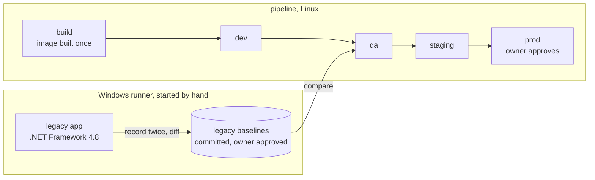

# .NET modernization, told from the quality side

**AI migrates, QE proves it's safe.**

An AI coding agent will convert a small legacy permit system from .NET Framework 4.8 (Web Forms, GraphQL, SQL Server) to .NET 10, Blazor and PostgreSQL. This repository is the quality engineering that decides whether that conversion can ship: a risk register written before any code moves, tests that pin down how the old system really behaves, proof that the new system matches it, and a gated release through four environments.

**Status, 2026-10-20:** the legacy app, the quality plan and most of the test framework are built and checked on a Mac. Nothing has run on GitHub yet, and the conversion waits for the owner's approval. [Details](#status)

The short version:

- The legacy app is small but realistic, and **deliberately built with real migration hazards**: rounding, time zones, collation, implicit row order, GraphQL library defaults, unencoded output. [The list](#planted-migration-hazards)
- The conversion runs **once, blind**: a separate agent session sees the legacy source and a short brief, never the tests, the risks or the data.
- **One test, two apps.** Every check is written once and runs against the legacy app or the modern one.
- Legacy behavior is **recorded on a Windows runner and committed** as baselines. The modern app is compared against them everywhere else.
- A **traceability gate** fails a stage when any risk lacks a passing test with real evidence behind it, and the gate's own code is mutation tested.
- **Free tools only.** No AWS account, no Kiro, no AWS Transform.

## The story

The idea comes from LAB200 "Introducing Kiro" at the AWS Public Sector AI Symposium in Ottawa (2026). The slides showed AWS Transform carrying a full Windows .NET stack to Linux. Converting the code is the part that is easiest to automate. What decides whether a migration like that can ship is everything around the conversion, and that is what this repository shows.

Everything here runs on free tools. No AWS account, Kiro or AWS Transform was used. Claude Code stands in for both of them, as the table below shows.

## Before and after

The migration on the slide, rebuilt here:

| Layer | Before (slide) | After (slide) | In this repo |
|---|---|---|---|
| Application | .NET Framework 3.5+, Web Forms UI, business logic and data access layers | Cross-platform .NET 10, Blazor UI, modernized business logic and data access | Before: .NET Framework 4.8 Web Forms, class libraries, ADO.NET, a GraphQL.NET 2.4 API. After: .NET 10, Blazor and Hot Chocolate GraphQL, to be written by the conversion |
| Database | SQL Server, schema and stored procedures | Aurora PostgreSQL, converted schema and stored procedures, migrated data | SQL Server 2022 → PostgreSQL 17, procedures converted to PL/pgSQL, data moved by a migration script |
| Deployment | Virtual machine running Windows Server | Amazon ECS or EC2 Linux | IIS Express on a GitHub Windows runner → a Linux container run with Docker Compose |

The "after" side is what the conversion has to produce. Until it runs, `modern/` holds a placeholder.

The tools on the slide, and the free stand-ins:

| On the slide | Free stand-in here |
|---|---|
| Kiro | Claude Code working from spec documents: a design and a plan for this repo, and the requirements, design and tasks the conversion agent writes before it converts |
| AWS Transform | Claude Code in a separate, blind session that runs once ([decision 0001](docs/decisions/0001-blind-conversion.md)) |
| AWS DMS and SCT | Procedures converted with the code, plus a migration script, proven by the [data migration validator](tests/src/migration/) |
| Aurora PostgreSQL | PostgreSQL in Docker |
| Amazon ECS or EC2 Linux | Docker Compose |
| CI/CD | GitHub Actions |

## AI migrates, QE proves it's safe

The conversion is the AI agent's job. Whether its output can ship is decided by the quality layer:

- a [test strategy](docs/quality/test-strategy.md) and a [risk register](docs/quality/risk-register.md) of 37 risks, written before any code is converted;
- characterization tests that pin what the legacy app actually does, including where it looks wrong;
- parity tests that hold the modern app to those recordings, with every accepted difference approved by the owner and given a reason;
- accessibility, security, performance and data migration checks;
- a [release plan](docs/quality/release-plan.md) with go/no-go criteria, a point of no return and a [rollback runbook](docs/quality/rollback-runbook.md).

Once the conversion lands, this section will hold a table of every defect the tests caught, each linked to its failing run and fix commit in the [defect log](docs/quality/defect-log.md). The log is empty today because nothing has been converted yet. Defects are never planted after the fact. If the conversion comes out clean, this section will say so.

## Planted migration hazards

These are **deliberate**. The legacy app was designed so that a straightforward conversion can break quietly, the way real migrations do. The conversion agent is not told about them. Whether it trips over any of them is whatever really happens.

| Hazard | In the legacy app | How a conversion breaks it |
|---|---|---|
| Fee rounding | `ROUND(@raw, 2)` in `usp_CalculateFee` rounds halves away from zero | .NET `Math.Round` rounds halves to even: RENO at 10.70 m² is 175.15 in legacy, 175.14 after a naive port |
| Discounts and tax | Non-profit beats senior, never stacked; 13% HST on the rounded fee | Stacked discounts, or tax on the unrounded amount, change totals |
| Business days | Due dates skip weekends and a holidays table, in Toronto time | PostgreSQL `to_char(d, 'Day')` pads day names, so weekends count; a Linux container's clock is UTC |
| Expiry | `DATEDIFF(day)` counts midnights crossed for the 180 day rule | Elapsed time intervals flip records on the boundary day |
| Name search | Case-insensitive, accent-sensitive collation; `=` ignores trailing spaces | PostgreSQL `LIKE` is case-sensitive and `=` keeps trailing spaces |
| Implicit order | Permit types and status history have no `ORDER BY` | PostgreSQL returns rows in physical order |
| Workflow errors | Status rules in a stored procedure, errors through `RAISERROR` | `RAISE EXCEPTION` arrives as a different error and needs its own mapping |
| Reference numbers | `PRM-2026-000123` built from an identity column | A sequence left behind the migrated rows collides on the first new submission |
| Data types | Four-place `money`, `varchar` in code page 1252, `NULL` vs empty vs blank, timestamps that do not exist in Toronto | Rounded money, mangled accents, collapsed nulls, shifted times |
| GraphQL contract | GraphQL.NET 2.4 names, nullability, scalars and error format | Hot Chocolate defaults differ, so partner clients break while every page still works |
| Security and accessibility | Names written unencoded with `<%= %>`, `ExposeExceptions = true`, `int.Parse` on `?id=`, a Phone label not tied to its field, red `#ff0000` error text | These must not be copied: the modern app is held to absolute bars, and the fix is recorded as an approved difference |

The reasoning behind each one, with references to the code and the seed data, is in section 5 of the [test strategy](docs/quality/test-strategy.md#5-risk-analysis). The synthetic seed data includes records aimed at each hazard (accented, mixed case and trailing space names, names containing HTML, half cent fees, weekend, holiday, leap day and daylight saving dates), listed in [`tests/seed-data/catalog.json`](tests/seed-data/catalog.json).

## How the quality gates work



- **One test, two apps.** Each page has a driver interface ([`types.ts`](tests/src/drivers/types.ts)) with a Web Forms implementation now and a Blazor one after the conversion. Tests talk to the interface, so parity means the same behavior, not the same HTML. The API needs no driver: both apps serve the same GraphQL operations.
- **Recorded baselines.** The legacy app runs only on .NET Framework, so only on Windows. A manual workflow records its normalized responses, twice, and fails if the two recordings differ in anything but the timestamp. The baselines are committed and reviewed like code. Every other run compares the modern app against them on Linux or a Mac, and a missing baseline fails the test. Recording refuses any target but the legacy app ([decision 0002](docs/decisions/0002-recorded-legacy-baselines.md)).
- **A normalizer that forgives almost nothing.** Before comparing, only key order, the first line of error messages and volatile values (new reference numbers, timestamps) are normalized, and volatile values are replaced only when they have the expected format. A trimmed space, a number sent as a string or a reordered list is a difference.
- **Approved differences.** Where the modern app should differ (a legacy security flaw fixed on purpose), the owner approves a narrow entry with a reason in [`approved-differences.json`](tests/approved-differences.json). The list starts empty. See [approved differences](docs/quality/approved-differences.md).
- **A traceability gate that refuses empty evidence.** Every risk has an ID and every test carries the IDs it covers as tags. The [gate](tests/src/gate/traceability.ts) fails a stage when a risk has no passing test, a test has no risk tag, a tag names an unknown risk, or a passing test examined nothing (a parity run that compared zero cases, a migration check that saw zero rows). Skipped tests never count, and a record mode run is refused outright ([decision 0005](docs/decisions/0005-traceability-with-real-evidence.md)).
- **Mutation testing of the gate itself.** A forgiving normalizer would turn every parity test green while proving nothing. Stryker mutates the parity engine and the gate, and the build fails below a mutation score of 85.
- **Build once, promote by digest.** The image is built once. Every later stage checks the digest before testing, and prod refuses to release anything else ([decision 0003](docs/decisions/0003-build-once-promote-by-digest.md)).

## Environments and gates

Each environment exists only while its pipeline stage runs.

| Stage | Runs on | What happens | Gate to move on | State today |
|---|---|---|---|---|
| build | Linux | Compile, lint, unit and mutation tests, build the image once | All green, mutation score at least 85 | Written; its steps run locally |
| dev | Linux | Start the image with PostgreSQL through Compose; smoke and API contract tests | All green | Written; red by design until the conversion replaces the placeholder |
| qa | Linux | API and UI parity against the legacy baselines, accessibility, security, Lighthouse, traceability gate | No unapproved difference or breaking schema change, budgets met, every qa risk covered with real evidence | In the workflow for the suites that exist; skipped until dev is green |
| staging | Linux | Load SQL Server with 50,000 applications, migrate, validate, then smoke and k6 on the migrated data | Validation green, migration within 10 minutes, p95 under 500 ms | After the conversion |
| prod | Linux | Owner approval, digest check, version tag, GitHub Release with the go/no-go record, smoke | Owner approves, digest matches | After the conversion |
| nightly monitor | Linux | Smoke against the released image; opens an issue on failure | Not a gate | After the first release |
| legacy | Windows, by hand | Build and run the legacy app with SQL Server; smoke, or record the baselines | Owner reviews and commits the baselines (approval point 2) | Written; first run after the push |

## Run it locally on a Mac

You need Docker Desktop, Node 22 (`nvm use` reads `.nvmrc`) and the .NET 10 SDK. The legacy solution builds on a Mac against .NET Framework reference assemblies, but .NET Framework itself only runs on Windows. SQL Server runs as an amd64 image under emulation on Apple Silicon: slower, fine at this size. Commands run from the repository root.

```sh
cp .env.example .env                     # throwaway passwords for local containers
(cd tests && npm ci && npx playwright install chromium)
```

**The test framework on its own** (no containers):

```sh
(cd tests && npm run typecheck && npm run lint)
(cd tests && npm run test:unit)          # parity engine, gate, seed, migration validator logic
(cd tests && npm run test:mutation)      # Stryker on the parity engine and the gate
```

**The legacy database** in Docker, with its characterization tests and the migration validator tests:

```sh
docker compose --profile legacy-db up -d --wait mssql
docker compose up -d --wait postgres     # used by the migration validator tests
(cd tests && npm run test:db)            # rebuilds the Permits database
```

**The legacy app in the Mono preview.** [`tools/mono-preview/`](tools/mono-preview/) serves the built Web Forms app on Mono, so the drivers and suites can be exercised before any Windows run. It is a test aid only: Mono is not .NET Framework, and nothing it produces is ever a baseline or evidence ([decision 0006](docs/decisions/0006-legacy-runs-on-windows-runners.md)).

```sh
dotnet build legacy/Permits.Legacy.sln -c Release
docker compose --profile legacy-db up -d --wait mssql
(cd tests && npm run db:legacy:reset -- --seed small)
docker compose --profile legacy-preview up -d --wait --build legacy-preview
open http://localhost:8081/Default.aspx
(cd tests && TARGET=legacy BASE_URL=http://localhost:8081 npm run test:smoke)
```

<details>
<summary>Exercise record and compare against the preview (scratch folder only)</summary>

Recorded files go to a temporary folder outside the repository. Never record into `tests/baselines/`: official baselines come only from the Windows runner.

```sh
scratch="$(mktemp -d)"
(cd tests && TARGET=legacy BASE_URL=http://localhost:8081 PARITY_MODE=record BASELINES_DIR="$scratch" npx playwright test specs/api)
(cd tests && npm run db:legacy:reset -- --seed small)
docker compose --profile legacy-preview up -d --wait --force-recreate --no-deps legacy-preview
(cd tests && TARGET=legacy BASE_URL=http://localhost:8081 BASELINES_DIR="$scratch" npx playwright test specs/api)
```

</details>

**The modern placeholder.** Until the conversion, `modern/` holds a stand-in that answers `GET /healthz` and returns 501 everywhere else, so the pipeline mechanics can be proven first.

```sh
docker compose up -d --wait --build app postgres
curl http://localhost:8080/healthz       # ok
(cd tests && TARGET=modern BASE_URL=http://localhost:8080 npm run test:smoke)   # fails on purpose, as dev does
```

Stop everything:

```sh
docker compose --profile legacy-preview --profile modern down --volumes
```

## Status

As of 2026-10-20 the repository exists only on the owner's machine. **Nothing has run on GitHub yet.**

Built, and checked on a Mac with Docker and the Mono preview:

- the legacy app (four Web Forms pages, a GraphQL API with five queries and two mutations, ADO.NET over stored procedures), its SQL Server database and characterization tests;
- deterministic synthetic seed data with a catalog of hazard records;
- the quality documents and seven decision records, as drafts for the owner's review;
- the test framework: parity engine, traceability gate, about 1,200 API parity cases (fees, due dates, search, lookups, workflow, GraphQL errors and schema), smoke tests, k6 journeys, Lighthouse CI configuration and a Bruno collection. The API cases were recorded and compared against the Mono preview in a scratch folder only;
- the data migration validator, tested between SQL Server and PostgreSQL on scratch tables (the real mapping is written once the converted schema exists);
- the pipeline (build, dev, qa) and the Windows workflow for the legacy app, written and clean under actionlint.

Next, in order:

1. The UI, accessibility and security suites, through the page drivers.
2. The owner pushes to a private GitHub repository. The first Windows runs prove the legacy recipe, which is unproven until then ([decision 0006](docs/decisions/0006-legacy-runs-on-windows-runners.md)).
3. The official legacy baselines, recorded on Windows and reviewed by the owner (approval point 2).
4. Approval point 1: the owner merges the foundation pull request ([what to review](docs/quality/approval-point-1.md)).
5. The blind conversion, once. The dev and qa stages catch what they catch, and every defect goes into the log.
6. The switch to a public repository (the prod approval needs it), then staging and prod, the releases `v1.0.0-rc.1` and `v1.0.0` (approval point 3 for each), and a rollback drill.

## Who did what

- **The owner, Ceylan Akyol,** is a Quality Engineer. They set the goals and made the key decisions: stay on .NET to match the slide, GraphQL in both apps, four environments, free tools only, the legacy app only on Windows runners, private first and public after review. They review the quality documents and approve at three points: the quality plan before the conversion, every change to the recorded baselines and every accepted difference, and each release's go/no-go and prod approval.
- **Claude Code** wrote the legacy app, the test framework, the pipeline and the first drafts of the documents, under the owner's direction. It never approves anything.
- **A separate Claude Code session** will do the conversion, standing in for AWS Transform. It sees only `legacy/` and the [conversion brief](docs/conversion/brief.md).

## What is in the repository

```
legacy/                 the "before": .NET Framework 4.8 app and SQL Server scripts
  db/                   schema, functions, procedures, reference data
  src/                  Permits.Web (pages and GraphQL), Permits.Core (rules), Permits.Data (ADO.NET)
modern/                 the "after": a placeholder until the conversion
tests/                  one TypeScript package for every test
  specs/                Playwright suites that run against either app: api, smoke (ui, a11y, security next)
  specs-legacy/         legacy-only smoke checks
  src/drivers/          the page driver interface and its Web Forms implementation
  src/parity/           record and compare, normalizer, diff, approved differences
  src/gate/             traceability gate and evidence from mutation, k6 and Lighthouse
  src/migration/        data migration validator
  src/seed/             deterministic synthetic data generator
  seed-data/            the generated small seed and the hazard catalog
  baselines/legacy/     recorded legacy baselines (empty until the first Windows record run)
  unit/  db/            Vitest: framework logic, and SQL characterization against SQL Server
  perf/  lighthouse/  bruno/   k6 journeys, Lighthouse CI, Bruno collection
tools/mono-preview/     local Mono preview of the legacy app (test aid only)
docs/quality/           strategy, risk register, release plan, runbook, logs, walkthrough
docs/decisions/         decision records
docs/conversion/        the brief, the only document the conversion agent sees
docs/superpowers/       the design and the build plan
.github/workflows/      pipeline.yml (build, dev, qa) and legacy.yml (Windows: smoke and record)
compose.yaml            SQL Server, the Mono preview, PostgreSQL and the modern app
```

## Documents

- [Walkthrough](docs/quality/walkthrough.md): the repository in ten minutes, with likely interview questions
- [Test strategy](docs/quality/test-strategy.md) and [risk register](docs/quality/risk-register.md) (generated from [`risks.json`](docs/quality/risks.json))
- [Release plan](docs/quality/release-plan.md), [rollback runbook](docs/quality/rollback-runbook.md) and [go/no-go template](docs/quality/go-no-go-template.md)
- [Approved differences](docs/quality/approved-differences.md) and [defect log](docs/quality/defect-log.md)
- [Approval point 1](docs/quality/approval-point-1.md): what the owner reviews before the conversion
- Decision records: [0001 blind conversion](docs/decisions/0001-blind-conversion.md), [0002 recorded baselines](docs/decisions/0002-recorded-legacy-baselines.md), [0003 build once, promote by digest](docs/decisions/0003-build-once-promote-by-digest.md), [0004 point of no return](docs/decisions/0004-point-of-no-return.md), [0005 traceability with real evidence](docs/decisions/0005-traceability-with-real-evidence.md), [0006 legacy on Windows runners](docs/decisions/0006-legacy-runs-on-windows-runners.md), [0007 private first, then public](docs/decisions/0007-private-first-then-public.md)
- [Conversion brief](docs/conversion/brief.md) and the [design](docs/superpowers/specs/2026-10-20-dotnet-migration-quality-design.md)
